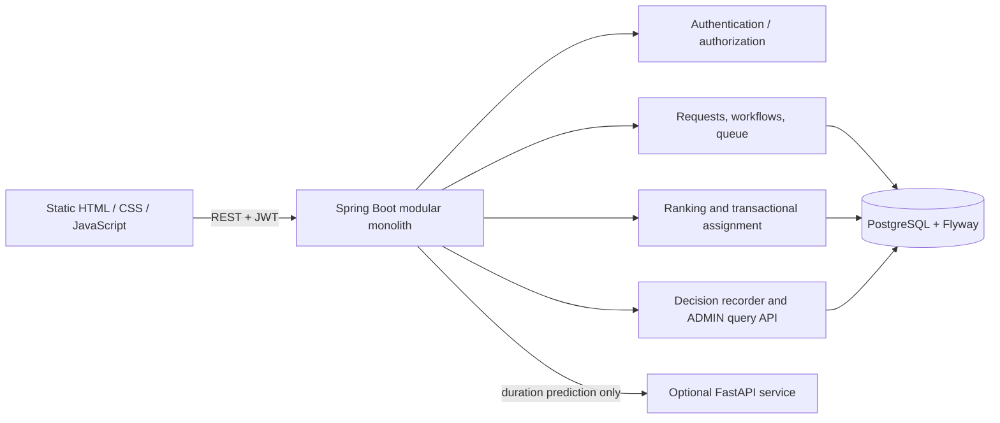
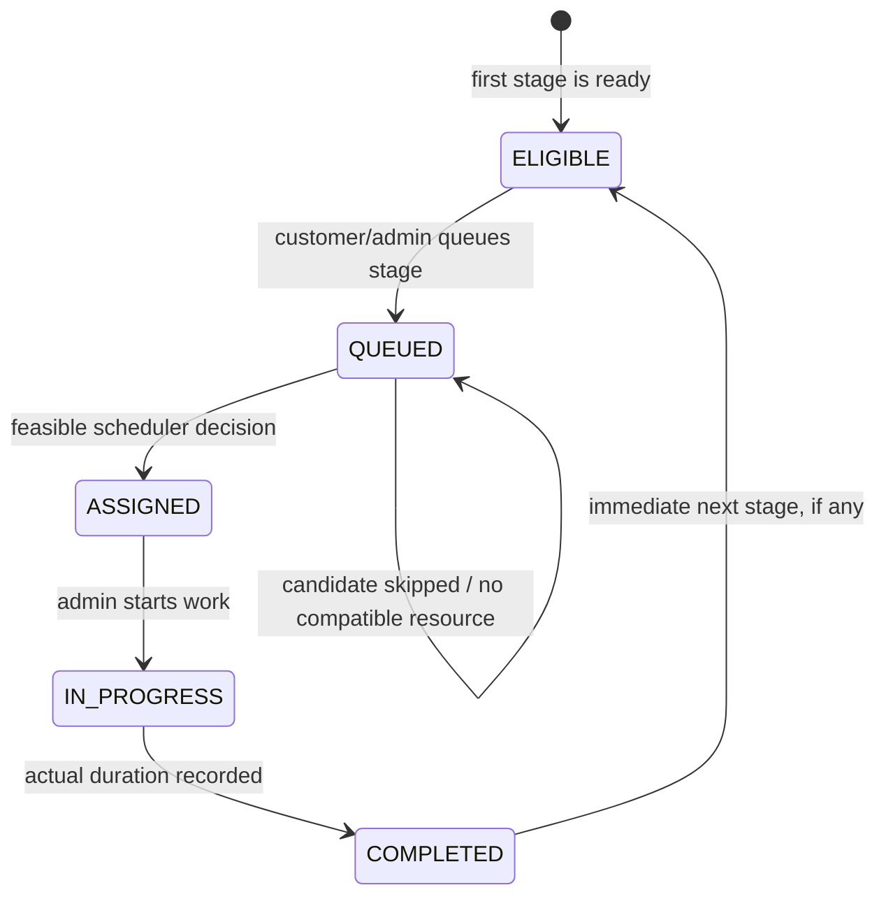

# OPTISERVE Project Demonstration Guide

**Audience:** project guide and co-guide
**Purpose:** deliver a clear 15–20 minute demonstration of the implemented workshop workflow, explain its technical depth, and answer questions accurately.

This guide describes the current `main` implementation. Use a disposable demo database or isolated demo records. The live application was reported by the project team as deployed to Render and already tested; the repository itself does not contain a Render service manifest or prove the current production health state.

## Presenter goal

Tell one connected story: a customer submits ordered workshop work; the workshop queues eligible stages; the backend ranks waiting candidates and checks real resource feasibility; an administrator can inspect the saved explanation; work progresses through assignment and completion. OPTISERVE combines structured workflow, resource capability, priority policy, and an auditable scheduling decision in one system.

**Opening line:** “A workshop needs more than a first-in-first-out list. OPTISERVE tracks each vehicle’s ordered service work, ranks eligible stages, checks which available resource can do the work, and records why it made that decision.”

## 1. Prepare before the presentation

### Environment and accounts

- Use the already-tested live application or rehearse against a disposable PostgreSQL database. The production deployment is reported as available by the project team; do not use demo requests or toggle automation in production unless that is explicitly the agreed demo environment.
- Have a provisioned ADMIN account and a USER customer account ready. Public registration creates a customer account, not an administrator.
- Open two browser profiles or windows: one signed in as ADMIN and one as USER. This avoids repeated login and keeps the roles visually clear.
- Confirm the application loads, both accounts can sign in, and the ADMIN can open **Decision Trace**. Keep credentials, tokens, and environment values out of screenshots and presentation notes.
- For local rehearsal, use JDK 21, PostgreSQL, and the project runbook in `README.md`. The frontend is served by Spring Boot. Flyway applies the schema on startup. The optional FastAPI duration service is not required for the scheduling walkthrough.

### Suggested small synthetic dataset

Set this up before the presentation. Names and registration numbers are synthetic.

| Item | Demo value | Configuration |
|---|---|---|
| Service type | Inspection | Default duration 20 minutes |
| Service type | Diagnostics | Default duration 45 minutes |
| Service type | Repair | Default duration 90 minutes |
| Resource | Bay A | AVAILABLE; compatible with Inspection and Repair |
| Resource | Diagnostic Bench | Initially OFFLINE; compatible with Diagnostics |
| Customer vehicle | `KA03MN0456` | Toyota Corolla, 2022 |
| Prepared request | Critical diagnostics | CRITICAL priority, Diagnostics stage, first stage queued |
| Live request | Normal inspection and diagnostics | Created during the demo on a second vehicle; stage order Inspection, then Diagnostics |

This creates a useful, truthful decision: the Critical Diagnostics candidate ranks first but cannot use the offline Diagnostic Bench. The scheduler records it as skipped for resource unavailability, continues evaluating, and can assign the Normal Inspection candidate to Bay A. Afterward, make the Diagnostic Bench AVAILABLE and run Assign next again: Critical Diagnostics should be ranked first and selected ahead of the queued Normal Diagnostics stage. This shows both the Critical precedence rule and how actual feasibility affects the result.

Prepare these records before the session:

1. Configure the service types and resource capabilities above.
2. Create the customer, vehicle, and queued CRITICAL Diagnostics request.
3. Confirm Bay A is AVAILABLE and the Diagnostic Bench is OFFLINE.
4. Leave no unrelated eligible work or WAITING queue entries. The automation coordinator operates across eligible and waiting work for the whole workshop.
5. Keep a second vehicle ready for the live Normal two-stage request, or register it during the customer section if time allows.

### Safe automation preparation

AUTO is persisted workshop-wide and can queue all currently ELIGIBLE stages and attempt to assign waiting entries after an application event. Do not enable it in a shared or production workshop containing unrelated eligible or waiting work. For a live AUTO demonstration, use a separate disposable database/workshop state with one prepared eligible request, one matching AVAILABLE resource, and no unrelated waiting/eligible work. If that isolated state is not available, show the setting and explain the behavior without enabling it.

## 2. Fifteen-to-twenty-minute walkthrough

### 0:00–1:00 — Set the problem and the product

**Navigate / do:** Open the application’s public page, then enter the authenticated workspace. Keep the landing-page scroll short.

**Say:** “A basic queue tells us who arrived first, but not whether a job is critical, whether an appointment is due, which resource can perform it, or how a multi-stage repair should progress. OPTISERVE models the complete service workflow and lets the backend make a consistent assignment decision.”

**Technical point:** The public landing-page examples are illustrative. The live workshop data appears in authenticated screens and comes from the backend API.

### 1:00–2:00 — Show the two roles

**Navigate / do:** In the ADMIN profile, open **Workshop overview**. Briefly show the navigation. In the USER profile, open **My service overview** and **My vehicles**.

**Say:** “Customers manage their own vehicles and service requests. Administrators configure workshop resources and services, manage the queue and assignments, and review operational decisions.”

**Technical point:** JWT bearer authentication is stateless. Public registration grants USER only; `/api/admin/**` is ADMIN-only. Customer data access is scoped to the signed-in customer.

### 2:00–3:00 — Explain capability and availability

**Navigate / do:** In ADMIN, open **Service types**, then **Resources**. Show Inspection, Diagnostics, Repair and the service types supported by each resource. Point out Bay A AVAILABLE and Diagnostic Bench OFFLINE.

**Say:** “A service type describes the work and its default duration. A resource must both support that service type and be available at assignment time. An offline resource is not eligible just because it has the right capability.”

**Technical point:** Compatibility and availability are checked by the backend during assignment. Duration is distinct from waiting time.

### 3:00–5:00 — Create an ordered customer request

**Navigate / do:** In the USER profile, choose **Service requests** and **Start a request**. Select or register the second vehicle (example: `KA03MN0457`, Honda Civic, 2021). Set priority to **Normal**. Select stages in this order: **Inspection**, then **Diagnostics**. Submit.

**Expected result:** A service request and ordered workflow are created. Inspection is the first eligible stage. Diagnostics remains pending until the preceding stage completes.

**Say:** “The customer describes the work as an ordered set of stages. The later stage exists in the workflow, but it cannot be queued until the previous stage is complete.”

**Technical point:** The service request owns a workflow of ordered stages. Request creation does not automatically enqueue the first stage while the workshop is in MANUAL mode.

### 5:00–6:00 — Queue eligible work and distinguish display order from rank

**Navigate / do:** Open the new request’s work order. Choose **Queue stage** for Inspection. In the USER profile, show **My service queue** briefly; then switch to ADMIN **Live queue** and refresh if needed.

**Expected result:** The Normal Inspection appears in the waiting queue. The prepared Critical Diagnostics request is also waiting. The queue screen lists by queue arrival, not scheduler evaluation order.

**Say:** “The queue is a view of waiting work. Its row order is not a promise about which job the scheduler will assign next.”

**Technical point:** Only waiting queue entries whose stages are QUEUED are ranked candidates. Queue membership and stage eligibility are separate state concepts.

### 6:00–8:00 — Run the Critical precedence and feasibility scenario

**Navigate / do:** In ADMIN **Live queue**, click **Assign next** once. The Critical Diagnostics candidate is ranked ahead of the Normal Inspection but is skipped because its only compatible resource is OFFLINE. The scheduler then evaluates and assigns the Normal Inspection to Bay A. Open **Decision Trace** and select the newest MANUAL assignment record.

**Expected result in the trace:** Candidate evaluation order begins with CRITICAL Diagnostics, marked SKIPPED / INFEASIBLE with reason `RESOURCE_UNAVAILABLE`. The Normal Inspection follows and is SELECTED / FEASIBLE. The detail reports the candidate order, score inputs, feasibility, reason, and outcome. The resource-unavailable candidate may have no matched resource or observed resource status recorded because no available compatible resource was found.

**Say:** “CRITICAL is a separate precedence class, not a large numeric score. It was considered first. It did not receive an assignment because no compatible resource was available, so the backend continued down the ranked list and assigned the next feasible candidate.”

**Technical point:** The backend preserves scheduler ranking in its candidate records. Ranking is separate from stage/queue revalidation and resource feasibility. A skipped candidate is not silently reordered in the UI.

### 8:00–10:00 — Show assignment lifecycle and stage handoff

**Navigate / do:** In ADMIN, open **Active work** or the Normal work order. Start the Bay A assignment, then complete it with a plausible actual duration (for example, 24 minutes). Return to the work order.

**Expected result:** The assignment moves through its lifecycle; Bay A becomes BUSY while work is active and returns to AVAILABLE after completion unless set OFFLINE. Inspection becomes complete and the next Diagnostics stage becomes ELIGIBLE. In MANUAL mode, it is not added to the queue automatically. Explicitly choose **Queue stage** on Diagnostics.

**Say:** “Completing a stage records actual duration and unlocks only its immediate successor. Manual operation leaves the queue decision to the administrator.”

**Technical point:** Assignment state transitions and queue/workflow changes are handled transactionally. Database constraints help prevent duplicate active assignments and waiting entries.

### 10:00–12:00 — Show the no-compatible-resource decision

**Navigate / do:** Keep the Diagnostic Bench OFFLINE. With Critical Diagnostics and Normal Diagnostics queued, click **Assign next**. Open the latest Decision Trace entry.

**Expected result:** No assignment is made because all currently queued candidates have been evaluated and neither has an available compatible resource. The overall result is **No compatible resource**. Each candidate has a recorded outcome and reason; neither appears as selected.

**Say:** “This is a different result from an empty queue. There was work to evaluate, but current resource feasibility prevented an assignment. The trace preserves what happened for each ranked candidate.”

**Technical point:** Candidate order/ranking, revalidation of the stage and queue entry, resource feasibility, and final outcome are distinct steps. A `NO_COMPATIBLE_RESOURCE` decision can record every candidate as skipped.

### 12:00–14:00 — Restore capacity and demonstrate successful Critical assignment

**Navigate / do:** In **Resources**, change Diagnostic Bench to AVAILABLE. Return to **Live queue**, click **Assign next**, then open **Decision Trace** and inspect the newest assignment.

**Expected result:** Critical Diagnostics is evaluated first and selected. Normal Diagnostics is lower-ranked and may be recorded as NOT EVALUATED because the scheduler stops after the successful assignment. The trace retains the exact backend evaluation order. Complete the Critical assignment if time permits, then assign and complete the Normal Diagnostics stage.

**Say:** “Now that a compatible resource is available, the Critical job is assigned first. Precedence determined the order; feasibility allowed the first candidate to be selected. These are separate facts in the trace.”

**Technical point:** Critical precedence is not preemption: existing active work is not interrupted. For non-critical candidates, the strategy uses numeric score factors; Critical candidates are ranked in their own precedence class.

### 14:00–15:00 — Capture and explain an empty-queue outcome

**Navigate / do:** After there are no eligible queued stages, click **Assign next** once more. Open **Decision Trace** and select the newest record, or filter the result to **No queued stage**.

**Expected result:** The backend records `NO_QUEUED_STAGE`, with zero candidates and no selected stage or resource. The detail heading explains why no assignment was made; it does not imply a candidate was selected.

**Say:** “This outcome means there was no eligible queued work to rank. It differs from no compatible resource, where candidate work existed but could not be assigned.”

**Technical point:** Decision Trace persists unsuccessful as well as successful assignment attempts.

### 15:00–16:30 — Show automation safely (optional)

**Navigate / do:** In the isolated demo state only, open ADMIN **Automation**. Point out the persisted MANUAL/AUTO mode and current MANUAL value. If the prepared isolated state is confirmed clean, switch to AUTO, create or queue the single prepared eligible test stage (or make its compatible resource available), and observe automatic queue reconciliation/assignment. Switch back to MANUAL afterward.

**Expected result:** In AUTO, the coordinator queues ELIGIBLE stages and attempts assignment after supported application events. Decision Trace records the trigger as AUTO reconciliation. In MANUAL, a request can remain eligible until explicitly queued and assigned.

**Say:** “AUTO is event-driven reconciliation, not a continuously polling background worker. Enabling it affects the whole workshop state, which is why I use an isolated demo dataset.”

**Technical point:** Changes are handled after the triggering transaction commits. If reconciliation fails, eligible work remains available for a later trigger. AUTO does not preempt active work.

### 16:30–18:00 — Close with architecture and boundaries

**Navigate / do:** Return to Decision Trace or the work-order detail. Use the diagram below and take questions.

**Say:** “The backend owns the authoritative workflow and assignment decision. A separate ML service can estimate service duration, but it does not choose the priority, resource, assignment, or waiting-time estimate. The persisted trace lets an administrator inspect the decision inputs and outcome.”

**Technical point:** Summarize modular monolith, transaction boundaries, persistence, authorization, ML boundary, and limitations. Do not claim ML improves real workshop outcomes: the bundled model training data is synthetic.

## 3. Decision Trace: what to point out

The ADMIN sidebar contains **Decision Trace**. The history view calls `GET /api/admin/scheduling/decisions`; opening a record calls `GET /api/admin/scheduling/decisions/{decisionId}`. The APIs are ADMIN-only. The history supports date, trigger, and outcome filters with pagination. The backend applies an inclusive `from` instant and exclusive `to` instant. The browser converts selected local calendar-date boundaries to ISO instants.

For an assignment detail, point to these in order:

1. **Overall result and trigger:** assigned, no compatible resource, or no queued stage; manual Assign next or AUTO reconciliation.
2. **Candidate count:** candidates evaluated versus total ranked candidates.
3. **Evaluation order:** the immutable order returned by the scheduler, not an order calculated in the frontend.
4. **Priority and score inputs:** base priority, aging, appointment bonus, and predicted-duration bonus for non-critical candidates.
5. **CRITICAL precedence:** shown as a separate class from the numeric score.
6. **Revalidation and feasibility:** recorded stage and queue statuses, feasibility, observed resource availability when captured, and reason.
7. **Outcome:** SELECTED, SKIPPED, or NOT EVALUATED. If all candidates are skipped, explain that all were evaluated and no candidate was selected. If an assignment succeeds early, lower-ranked candidates may be recorded as not evaluated.

Decision snapshots persist with the scheduling attempt in its transaction. If that transaction rolls back, the trace is not committed separately as a successful decision. V11 creates `scheduling_decisions` and `scheduling_candidate_evaluations`; the latter preserves a unique evaluation order per decision.

**Historical resource identity limitation:** snapshots expose resource identifiers and recorded availability where available, but they do not persist a resource name or a separate historical compatibility explanation. The UI truthfully falls back to identifiers / “Not recorded.” It does not look up today’s resource name and present it as a historical fact. A future backend enhancement could snapshot the resource name and relevant service-type identity with each scheduling decision.

## 4. Scheduler explanation in plain English

1. The scheduler considers only queue entries that are WAITING and stages that are QUEUED.
2. CRITICAL candidates rank before every non-critical candidate. This is precedence, not a numeric score and not preemption.
3. Within the non-critical group, the current strategy scores URGENT at 300 base points, APPOINTMENT at 200, and NORMAL at 100. It adds one point per waiting minute, 25 points for an appointment that is due, and a bounded short-duration bonus of up to 30 points for work under the 60-minute reference. Equal scores use deterministic queue-time/request-time/identifier tie-breakers.
4. The assignment service rechecks the stage and queue entry under lock, then searches for an AVAILABLE resource compatible with the stage’s service type. If a candidate cannot be assigned, it records the reason and considers the next ranked candidate.
5. After selection, it records the assignment and decision in the transaction. The displayed queue order remains arrival order; it is not the scheduler’s ranked order.

Waiting-time estimates are recalculated from current queue and resource state. They are estimates, not guaranteed start times or service-duration predictions.

## 5. Architecture and workflow diagrams

The backend is a Java 21 / Spring Boot modular monolith with PostgreSQL, Spring Data JPA, Spring Security, Bean Validation, Maven, and Flyway. The frontend is a static single-page application using vanilla JavaScript and CSS. The optional ML service is Python 3.12, FastAPI, and scikit-learn. DTOs form the REST boundary; controllers do not expose JPA entities.

## 6. Implemented feature map and honest boundaries

| Area | Current implementation and demo claim |
|---|---|
| Customer and vehicles | USER registration/profile and vehicle management; customer records are scoped to the signed-in account. |
| Service requests | Ordered workflows with stage eligibility and lifecycle. First stage is initially eligible; later stages wait for their predecessor. |
| Service catalog/resources | ADMIN configures service types, default durations, resource status, and compatible service types. |
| Queue and wait estimate | Customer/admin queue views, explicit queue actions in MANUAL mode, dynamic backend wait-time estimates. Queue display is by arrival, scheduler ranking is separate. |
| Scheduling | Deterministic backend strategy with CRITICAL precedence, non-critical scoring, resource feasibility, transactional assignment, and outcomes for assigned/no compatible resource/no queued stage. |
| Assignment execution | ADMIN can start and complete work; completion records actual duration, releases the resource unless OFFLINE, and unlocks the next workflow stage. |
| Decision Trace | Persisted decision and candidate snapshots, ADMIN history/detail APIs and frontend; records candidate order, ranking inputs, feasibility, outcomes, and reasons. |
| Automation | Persisted MANUAL/AUTO mode; AUTO reconciles after supported application events. No continuous polling retry loop. |
| Analytics | Historical completion/request/prediction-error metrics plus current operational counters. Historical and live values have different date semantics. Meaningful prediction-error results require completed data with predictions. |
| Duration ML | Optional advisory service-duration prediction; backend default duration is used for outage/invalid/unsupported results. It does not choose scheduler order or waiting time. Training data is synthetic. |
| Real-time notifications | No WebSocket/EventSource push is implemented; refresh/navigation/actions fetch current data. |
| Other role types | USER and ADMIN are implemented. Separate advisor/technician/manager roles are not. |
| Customer notifications/no-show prediction | Not implemented. |

The project team reports that this current implementation is deployed to Render and has been tested live. `OPERATIONS.md` explains that the repository has no Render service manifest and cannot verify the current dashboard configuration or production health from source alone.

## 7. Likely questions and concise answers

**What problem does OPTISERVE solve?**
It gives a workshop one structured way to manage vehicle service requests, ordered work stages, queue priorities, resource capability, assignments, and explanations of scheduling outcomes.

**Is the scheduler AI?**
No. Assignment ranking and feasibility are deterministic backend rules. The separate ML integration may estimate service duration; it does not rank jobs, choose resources, assign work, or predict wait time.

**How is CRITICAL different from a high score?**
CRITICAL is a separate precedence class ranked ahead of all non-critical candidates. It is not represented as a larger numeric score. Feasibility is checked afterward, so an unavailable Critical job can be skipped while the next feasible job is assigned.

**Does CRITICAL interrupt ongoing work?**
No. It affects the order of queued candidates only. An active assignment is not preempted.

**Can the scheduler guarantee that normal work never waits too long?**
No formal starvation-free deadline is promised. Non-critical waiting age adds one point per minute within that group, but this is not a time-bound service guarantee. CRITICAL precedence remains separate.

**Why might a candidate be skipped?**
The stage or queue entry may no longer be current, or there may be no compatible AVAILABLE resource. The trace stores a specific reason and feasibility/outcome status.

**What is the difference between NO_COMPATIBLE_RESOURCE and NO_QUEUED_STAGE?**
NO_COMPATIBLE_RESOURCE means there were current queued candidates but none could be assigned to an available compatible resource. NO_QUEUED_STAGE means there was no eligible queued candidate to rank.

**Does AUTO run continuously?**
No. It reconciles after supported application events such as request creation, queue changes, assignment completion, resource changes, and enabling AUTO. A later event may be needed to retry work that remains blocked. It does not preempt active assignments.

**What does Decision Trace store?**
It stores the scheduler decision and candidate evaluation snapshots, including order, priority/score inputs, queue and stage statuses, feasibility, resource fields where captured, outcome, and reason. Snapshots are persisted transactionally.

**Why is the resource sometimes an ID instead of a name?**
The current snapshot stores the resource identifier but not a historical resource name or separate compatibility narrative. The UI avoids fetching a current name and implying it was captured in the past. Persisting resource name and service-type identity in future snapshots is a possible backend enhancement.

**Why separate ranking from assignment?**
Ranking gives a deterministic candidate order. Assignment must revalidate current state, lock the relevant stage/queue/resource, check feasibility, and persist the result safely. A ranked candidate can become stale or have no available compatible resource.

**What happens if ML is unavailable?**
The backend uses the service type’s default duration. Duration prediction is advisory; the core scheduling and assignment workflow remains in Spring Boot.

**Is the ML model proven to improve real workshops?**
No such claim is supported. The checked-in training dataset is synthetic and demonstrates the integration path, not real-world accuracy or business impact.

**Is the wait estimate guaranteed?**
No. It is recalculated from current queue and compatible-resource state and can change when the workshop changes.

**How are the APIs protected?**
JWT bearer authentication is stateless and passwords are BCrypt-hashed. ADMIN endpoints, including scheduling decision history and detail, require ADMIN. Public registration creates USER accounts only.

**What is the deployment story?**
The project team reports that the application is deployed to Render and live-tested. The repository’s `OPERATIONS.md` documents health checks and notes that dashboard settings and live production health cannot be proven from the repository alone.

## 8. Recovery and fallback plan

- **Trace history is empty:** refresh; remove filters; confirm that an Assign next attempt was made in this database. An empty history does not mean the API is missing.
- **Normal candidate is selected before the Critical test candidate:** stop and inspect the exact backend order and the prepared data. Confirm the request really has CRITICAL priority, both stages are queued, and the expected application build/database is open. Do not narrate a fabricated order or claim the frontend sorts it.
- **Critical is first but skipped:** inspect the resource’s current status and service-type compatibility. This is expected while Diagnostic Bench is OFFLINE. Restore AVAILABLE only for the later success step.
- **Assignment returns no compatible resource unexpectedly:** check that the planned resource is AVAILABLE and compatible. The recorded trace can help explain what the backend observed.
- **Assignment returns no queued stage:** verify that the stage is eligible and explicitly queued in MANUAL mode. For the planned empty-queue demo, this is intentional.
- **AUTO is unsafe to show:** leave MANUAL enabled and explain the event-driven behavior using the Automation screen. Never enable AUTO while unrelated workshop work may be consumed.
- **ML service is unavailable or provenance says DEFAULT_FALLBACK:** continue the demo. Explain that the service-type default is used and that ML is not authoritative for scheduling.
- **Live service or network is unavailable:** use a locally rehearsed disposable database and the same synthetic data. Clearly label it as a local demo environment.
- **Time is short:** prioritize request → queue → Assign next → Decision Trace → start/complete → next stage. Omit analytics and the optional AUTO action.

## 9. Final presenter checklist

- [ ] Correct demo environment and expected build are open; two role accounts are ready.
- [ ] Synthetic demo data only; no unrelated eligible/waiting work before any AUTO demonstration.
- [ ] Bay A AVAILABLE for Inspection; Diagnostic Bench OFFLINE for the first Critical-vs-Normal decision.
- [ ] Critical Diagnostics request is queued before the live Normal Inspection/Diagnostics workflow.
- [ ] Explain that the queue list is arrival order and the trace order is the backend’s evaluation order.
- [ ] After the first trace, restore Diagnostic Bench to AVAILABLE to show Critical selected first.
- [ ] Complete work with plausible actual durations; point out next-stage eligibility and explicit MANUAL queueing.
- [ ] Generate the no-compatible-resource and no-queued-stage outcomes intentionally and explain their difference.
- [ ] Keep AUTO optional and isolated; restore MANUAL afterward.
- [ ] State the limitations accurately: no historical resource name/service-type identity in trace snapshots, synthetic ML data, dynamic wait estimates, no push notifications, and no formal starvation deadline.
- [ ] Close on the technical contribution: deterministic precedence and scoring, live feasibility checks, transactional assignment, and persisted explainable decision records.
