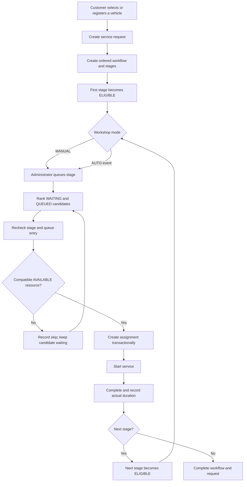
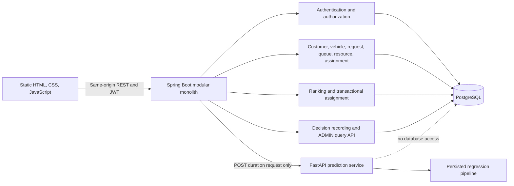
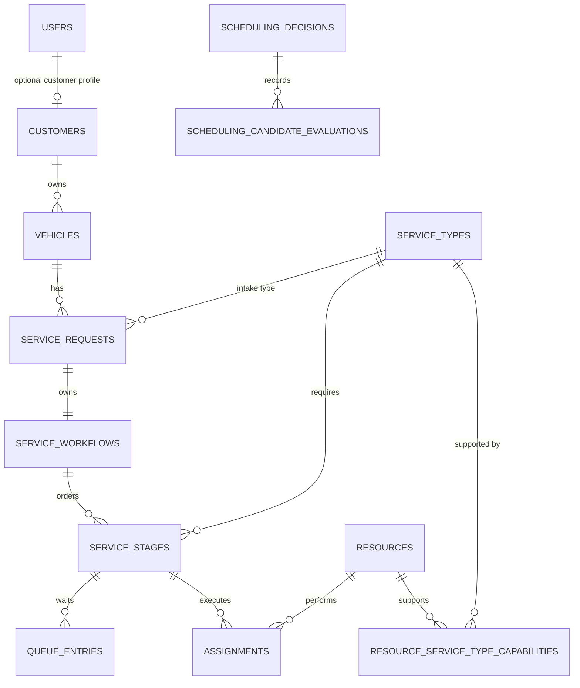
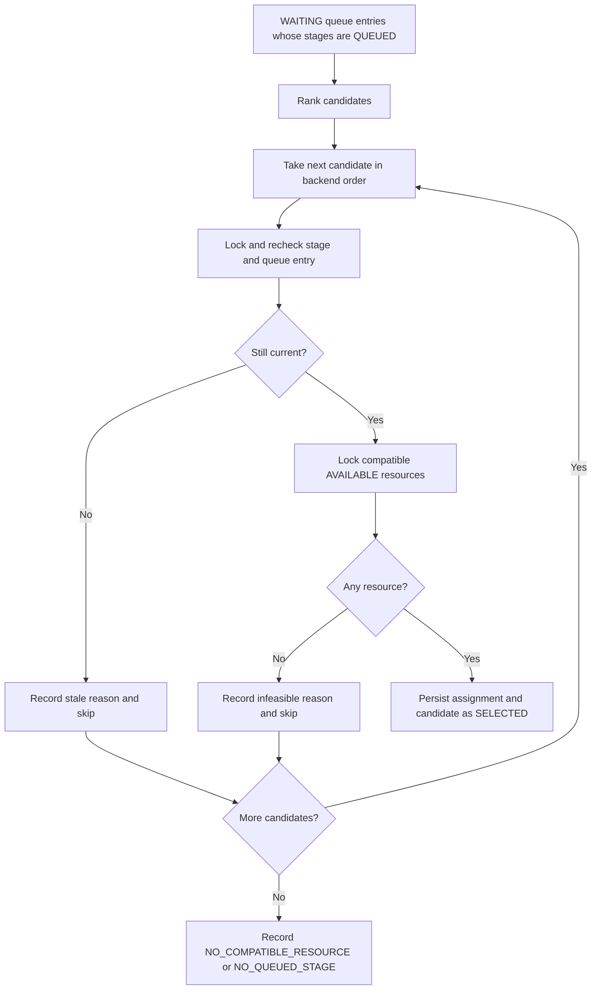
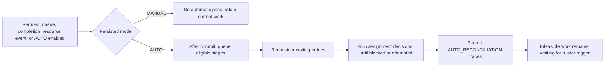

# OPTISERVE — Intelligent Service Operations & Resource Orchestration Platform

OPTISERVE helps an automotive workshop coordinate customer requests, ordered service work, waiting queues, and limited workshop resources. A first-come, first-served list cannot account for critical work, appointments, time already spent waiting, different service durations, or which resource can perform each stage. OPTISERVE combines those rules into a connected workflow, assigns only work that a compatible available resource can perform, and records why each scheduling attempt succeeded or did not.

Customers use OPTISERVE to manage their profile and vehicles, request service, and follow their work. Workshop administrators manage service types and resources, operate the queue, track assignments, review analytics, configure MANUAL/AUTO operation, and inspect the persisted Scheduling Decision Trace.

The scheduling engine is deterministic backend logic. A separate optional machine-learning service estimates **service duration only**; Spring Boot remains authoritative for queue ranking, resource selection, assignment, and waiting-time estimates.

## Contents

- [Key features](#key-features)
- [Why OPTISERVE exists](#why-optiserve-exists)
- [End-to-end example](#how-it-works-an-end-to-end-example)
- [Customer and administrator experiences](#customer-and-administrator-experiences)
- [Screens and visual references](#screens-and-visual-references)
- [Architecture](#architecture)
- [Multi-stage workflows](#multi-stage-service-workflows)
- [Queue and hybrid scheduling](#queue-management-and-hybrid-scheduling)
- [Resources and assignments](#resources-and-assignment-lifecycle)
- [MANUAL and AUTO modes](#manual-and-auto-workshop-operation)
- [Scheduling Decision Trace](#scheduling-decision-trace)
- [ML service-duration prediction](#ml-service-duration-prediction)
- [Waiting-time estimates](#dynamic-waiting-time-estimates)
- [Database and migrations](#database-and-migrations)
- [API overview](#api-overview)
- [Technology stack](#technology-stack)
- [Repository structure](#repository-structure)
- [Local setup](#local-setup)
- [Testing](#testing-and-quality-checks)
- [Security and reliability](#security-and-reliability)
- [Current limitations](#current-limitations)
- [Implementation status](#implementation-status-and-future-improvements)
- [Further documentation](#further-documentation)
- [Contributing](#contributing)
- [License](#license)
- [Project information](#project-information)

## Key features

- Customer accounts, profiles, and vehicle management.
- Service requests containing ordered, multi-stage workflows.
- Queueing of eligible stages and live waiting-time estimates.
- CRITICAL precedence and explainable scoring for non-critical work.
- Resource availability and service-type compatibility checks.
- Transactional assignment and service execution lifecycle.
- Persisted MANUAL/AUTO workshop mode with event-driven reconciliation.
- ADMIN-only decision history with ordered, candidate-level scheduling traces.
- Optional FastAPI service-duration prediction with safe default-duration fallback.
- Operational analytics, responsive workspaces, and role-specific navigation.

## Why OPTISERVE exists

Workshop work is not a single line of interchangeable jobs. One vehicle can need inspection, diagnostics, and repair in sequence; each stage can require different skills or equipment. An urgent or critical request may arrive while another job is already underway. Appointments become due, resources change availability, and a duration estimate can affect the order in which non-critical work is considered.

A simple queue does not express these relationships. OPTISERVE models the work as ordered stages, separates scheduler ranking from assignment feasibility, and keeps the backend as the authority for operational state. The goal is a clearer handoff from customer request to completed service, with an explanation that an administrator can review afterward.

## How it works: an end-to-end example

Suppose a customer brings a Hyundai i20 in for inspection, diagnostics, and repair.

1. The customer registers an account and adds the vehicle.
2. The customer creates a request and chooses the ordered stages: Inspection → Diagnostics → Repair.
3. The backend creates the request, workflow, and stages atomically. The first stage is `ELIGIBLE`; later stages are `PENDING`.
4. In MANUAL mode, an administrator queues the eligible stage. In AUTO mode, an application event can queue eligible stages through automation reconciliation.
5. The scheduler ranks waiting, queued stages using priority rules and the current scoring inputs.
6. The assignment service rechecks the selected candidate and searches for an `AVAILABLE` resource compatible with Inspection.
7. If feasible, the backend creates an assignment, marks the stage `ASSIGNED`, the resource `BUSY`, and removes the queue entry—all in the same transaction.
8. An administrator starts the assignment, moving it to `IN_PROGRESS`.
9. On completion, the backend records actual service duration and releases the resource unless it is `OFFLINE`.
10. Only the immediate next stage becomes `ELIGIBLE`. It must be queued before it can be assigned in MANUAL mode.
11. Completing the final stage completes the workflow and service request.



### The core records

| Concept | What it represents |
|---|---|
| **Service request** | A customer’s request for work on one of their vehicles. It has a priority and owns one workflow. |
| **Service workflow** | The ordered plan of work for a service request. It becomes complete when its final stage completes. |
| **Service stage** | One executable step in the workflow, with its own service type and lifecycle status. This is the unit that is queued and assigned. |
| **Queue entry** | A record that an eligible stage is waiting. It stores queue time and status; it is not a permanent queue-position or wait-time promise. |
| **Resource** | A workshop resource, such as a bay or service counter, with a status and a set of compatible service types. |
| **Assignment** | The link between a service stage and a resource that executes it, including assigned, start, completion, predicted-duration, and actual-duration data. |

## Customer and administrator experiences

### Customers (`USER`)

Customers can register and sign in, save their profile, add and manage their own vehicles, create service requests, and view their service requests and ordered stages. They can view their own queue entries and the current estimated wait for queued work. Assignment and service history is available where an assignment exists. Customer API access is scoped to the signed-in account; foreign record identifiers are not used to reveal another customer’s data.

### Workshop administrators (`ADMIN`)

Administrators use the workshop console to review the current operation and analytics; create, edit, and deactivate service types; configure resources, status, and compatible service types; inspect workshop requests and queue entries; manually request the next assignment; start and complete work; change MANUAL/AUTO mode; and browse persisted Scheduling Decision Trace history and details.

The implemented role model is **USER and ADMIN**. Separate technician, service-advisor, and manager roles are not implemented. Public account registration always creates a USER account. Administrator access is provisioned separately; there is no public admin-registration endpoint.

## Screens and visual references

The public page includes a service-work-order illustration to explain the product. It is static demonstration content, not live workshop data. The checked-in screenshot is a genuine capture of that public page; the embedded workflow and queue examples are illustrative.

[View the public landing-page capture](visual-audit/final-public-1280x800.png).

The `visual-audit/` directory also contains frontend review captures. Files named `mocked-*` use mocked API fixtures and show UI appearance, not a live backend session. The live authenticated application loads operational values from same-origin APIs.

## Architecture

OPTISERVE is a **modular monolith**: core workshop operations run in one Spring Boot application and share one PostgreSQL database. Backend modules keep responsibilities organized without splitting core scheduling into microservices. A separately runnable FastAPI service provides only the duration-prediction boundary.



The backend follows this dependency direction:

```text
REST Controller → Application Service → Domain / Business Logic → Repository → PostgreSQL
```

Controllers use request and response DTOs rather than exposing JPA entities. Application services own transaction boundaries; domain logic enforces state transitions; repositories persist and query the model. Spring Security protects APIs, Bean Validation checks inputs, and a global exception handler provides consistent API errors.

### Frontend

The frontend is a dependency-free static single-page application served by Spring Boot from `optiserve-backend/src/main/resources/static/`. It calls the same-origin REST APIs and provides a public product page, customer workspace, and administrator workshop console. Screens cover work orders, queues, resources, service types, history, analytics, automation, and Decision Trace. Responsive layouts and API loading, empty, validation, partial-unavailable, and error states are implemented.

There are no WebSocket or EventSource updates. The browser reloads data on navigation, explicit refresh, and after actions. The public marketing illustrations make no live API requests.

### Architecture and workflow model



The Decision Trace tables intentionally snapshot operational identifiers and evaluation values. Candidate rows reference their parent decision; resource, stage, request, and workflow identifiers are stored as snapshot values rather than historical joins that could change the meaning of an old decision.

## Multi-stage service workflows

A service request owns one ordered workflow, and each stage requires one service type. The first stage starts `ELIGIBLE`; the later stages start `PENDING`. Completing a stage makes only its immediate successor eligible. That next stage is not automatically queued in MANUAL mode.

```text
PENDING → ELIGIBLE → QUEUED → ASSIGNED → IN_PROGRESS → COMPLETED
```

Workflows use `ACTIVE`, `COMPLETED`, or `CANCELLED`. Stages can also be `CANCELLED` where allowed by the domain. A queue entry can be `WAITING` or `REMOVED`. Assignments can be `ASSIGNED`, `IN_PROGRESS`, `COMPLETED`, or `CANCELLED`.

Creating a request with ordered service types creates the request, its workflow, and all supplied stages in one transaction. It does not select a resource or add a queue entry. A service type on a stage is authoritative for that stage’s required capability; the request also retains an intake service type for the existing schema.

## Queue management and hybrid scheduling

The queue represents stages waiting for work. Only a stage in `ELIGIBLE` state can be queued. Queueing atomically creates a `WAITING` queue entry and changes the stage to `QUEUED`. Removing a waiting entry marks it `REMOVED` and returns its active stage to `ELIGIBLE`; it does not cancel the request.

The queue screen presents arrival order. It does not claim that the first row is the next scheduler assignment. The backend scheduler ranks candidates using current inputs and the assignment process checks feasibility separately.

### Priority classes and CRITICAL precedence

OPTISERVE supports `CRITICAL`, `URGENT`, `APPOINTMENT`, and `NORMAL` requests. A CRITICAL request is ranked ahead of every non-critical candidate. This is a separate precedence class, not a large numeric score. CRITICAL does **not** interrupt active work: it waits for a compatible resource to become available and is considered at the next scheduling decision.

If a CRITICAL candidate has no compatible available resource, it remains waiting and the assignment process may continue to a lower-ranked candidate that is feasible. When no candidate is assignable, the queue remains intact for a later decision.

- **Compatible resource available:** the CRITICAL candidate ranks first and is selected if it remains current and can be claimed.
- **All compatible resources busy:** no resource is available to claim, so the Critical stage stays waiting. A later manual attempt or AUTO-triggering event can reconsider it.
- **No compatible resource:** the candidate is recorded as infeasible; if no other candidate is assignable, the overall result is `NO_COMPATIBLE_RESOURCE`.
- **Lower-ranked candidate is feasible:** the scheduler can assign it while the higher-ranked Critical candidate remains queued.
- **Work already in progress:** it is never interrupted to make room for a Critical request.

### Non-critical score

Within the non-critical group, the current score is:

```text
Base priority + waiting-time aging + due-appointment bonus + bounded short-duration bonus
```

| Non-critical priority | Base points |
|---|---:|
| `URGENT` | 300 |
| `APPOINTMENT` | 200 |
| `NORMAL` | 100 |

- **Waiting-time aging:** adds 1 point per elapsed minute in the queue.
- **Due appointment:** adds 25 points when an `APPOINTMENT` request’s appointment time has arrived.
- **Short-duration bonus:** for a predicted duration below a 60-minute reference, the bonus is `min(30, max(0, 60 − durationMinutes))`. The maximum is 30 points. A missing duration contributes 0.
- **Tie-breaking:** earlier queue-entry time, earlier request creation time, then queue-entry UUID, in that order.

Aging increases a non-critical candidate’s score over time and can help long-waiting work outrank newer or higher-base-priority non-critical work. It is not a formal starvation-free guarantee or deadline; strict CRITICAL precedence remains in effect, and resource compatibility can also constrain progress.

### Ranking is not assignment feasibility

The scheduler’s job is to produce candidate order. The assignment service then performs the state-changing checks:

1. Recheck under lock that the stage still exists and is `QUEUED`.
2. Recheck under lock that its queue entry is still `WAITING`.
3. Lock and find a resource that is both `AVAILABLE` and compatible with that stage’s service type.
4. Assign the first ranked candidate that passes those checks. If a candidate is stale or no compatible resource is available, record a skip and continue to the next candidate.

**Example:** a CRITICAL Diagnostics stage ranks first, but its only Diagnostics resource is offline. The assignment attempt records the Critical stage as skipped for resource unavailability, then checks the next candidate. If a NORMAL Inspection stage can use an available inspection bay, that Normal stage can be assigned while the Critical stage remains queued. If the Diagnostics bay becomes available, the next decision will rank the Critical stage first again.



The result `NO_COMPATIBLE_RESOURCE` means current queued work was evaluated but none could be assigned to a compatible available resource. `NO_QUEUED_STAGE` means there was no current candidate to rank. Neither result means a candidate was selected.

## Resources and assignment lifecycle

A `Resource` is a generic workshop capacity unit such as a service bay or counter. The workshop administrator manages its name, status, and compatible service types. A resource status is:

- `AVAILABLE`: may be selected if it supports the stage’s service type.
- `BUSY`: has an active assignment and cannot be assigned another one.
- `OFFLINE`: unavailable for assignment.

The backend does not assign incompatible resources. During assignment, it locks the stage, waiting queue entry, and a compatible available resource, then persists the assignment and state changes atomically. Where more than one available compatible resource exists, the current query selects by resource name then resource UUID.

Assignments progress from `ASSIGNED` to `IN_PROGRESS` to `COMPLETED`. Starting work changes both assignment and stage state. Completion stores a supplied positive actual duration, or uses elapsed execution time if one is not supplied; the resource returns to `AVAILABLE` unless it has been marked `OFFLINE`. Completing a stage unlocks its immediate successor. Completing the final stage completes the workflow and request.

Database transactions, pessimistic locks, foreign keys, checks, and partial unique indexes work with domain rules to prevent conflicting active assignments and duplicate waiting entries. These protections make the database part of the correctness boundary, not just a storage layer.

## MANUAL and AUTO workshop operation

The persisted workshop mode defaults to `MANUAL` through Flyway migration V10.

| Mode | Behavior |
|---|---|
| **MANUAL** | Administrators explicitly queue eligible stages and can invoke Assign next. Existing queue entries and active assignments remain. |
| **AUTO** | Application events trigger reconciliation: eligible stages are queued, existing waiting entries are reconsidered, and the assignment service is called repeatedly up to the current number of waiting entries, stopping when no assignment succeeds. |

AUTO reconciliation can be triggered by enabling AUTO, service request creation, queue changes, assignment completion, and relevant resource status or compatibility changes. Events are handled after their originating transaction commits. If reconciliation fails, the eligible work remains available for a later trigger. A stage with no compatible available resource stays waiting.

AUTO is **event-driven**, not a continuously running scheduler or polling loop. Switching back to MANUAL stops future automatic reconciliation while retaining queue entries and active assignments. Neither mode preempts work already in progress.



## Scheduling Decision Trace

Scheduling Decision Trace makes scheduler outcomes inspectable instead of leaving the assignment as a black box. Each manual Assign next attempt and AUTO reconciliation records a decision and its candidate evaluations in the same transaction as the scheduling attempt. If that transaction rolls back, its trace rolls back with it.

A decision snapshot includes:

- Evaluation time, trigger, strategy name/version, overall result and reason.
- Candidate count and evaluated-candidate count.
- For each ranked candidate: evaluation order; operational identifiers; queue and stage statuses; priority; queue time and waiting age; appointment time/due status; predicted service duration and provenance; score components; feasibility; observed resource status and matched resource ID where captured; candidate outcome and reason.
- The selected stage/resource IDs when an assignment succeeds.

Candidate outcomes are `SELECTED`, `SKIPPED`, or `NOT_EVALUATED`. A lower-ranked candidate can be marked NOT_EVALUATED after a higher-ranked candidate is successfully assigned. For unsuccessful decisions, the trace distinguishes ranking from stage/queue revalidation, resource feasibility, candidate outcomes, and the overall result. No selected candidate is implied for unsuccessful results.

Supported overall outcomes are:

- `ASSIGNED`
- `NO_COMPATIBLE_RESOURCE`
- `NO_QUEUED_STAGE`

The persisted trace is an immutable historical snapshot in the application contract, not the current queue. The API exposes it through read-only GET routes; the frontend reads the backend’s recorded order and does not sort candidates again.

### ADMIN endpoints

| Method and endpoint | Purpose |
|---|---|
| `GET /api/admin/scheduling/decisions` | Browse the decision history, newest first. Supports optional `from`, `to`, `trigger`, and `outcome` filters plus `page` and `size` pagination. `from` is inclusive; `to` is exclusive. Page size is bounded to 1–100 (default 25). |
| `GET /api/admin/scheduling/decisions/{decisionId}` | Read one decision and its candidate evaluations in recorded evaluation order. |

Both routes require the ADMIN role. The history records resource identifiers and status evidence but does **not** snapshot historical resource names or the relevant service-type identity/compatibility narrative. The interface therefore shows the recorded ID or “Not recorded” and never fetches a current resource name as if it were historical. A future backend enhancement could snapshot resource name and service-type identity alongside each decision.

## ML service-duration prediction

The optional Python FastAPI service predicts an expected service duration in minutes. Its input includes service type, vehicle make/model/year, and day of week; its response contains `predictedDurationMinutes`. A shared JSON request/response example lives in [`contracts/ml-duration-prediction/`](contracts/ml-duration-prediction/).

The bundled `ml-service/data/service_history.csv` is synthetic data generated by `training/generate_synthetic_data.py`. The training pipeline builds shared inference/training features, including vehicle age and one-hot encoded service, make, model, and weekday features. It compares Linear Regression and a 200-tree Random Forest using validation data, refits the selected pipeline on training plus validation partitions, and evaluates on an untouched test partition. The committed model artifact is loaded by the FastAPI service. These synthetic-data metrics measure fit to the simulator; they do **not** demonstrate real-world accuracy or workshop impact.

Spring Boot calls FastAPI through the `ServiceDurationPredictor` boundary. It sends service type, vehicle make/model/year, and a weekday derived from the appointment date when present or request date otherwise, interpreted in the configured service time zone (default `Asia/Kolkata`). The integration uses a bounded connection/response timeout, validates the response, and falls back to the service type’s configured default duration when the service is unavailable, the input year is outside the supported 2008–2026 range, or the response is invalid. Stored provenance is:

- `ML_MODEL`: a valid model result was accepted.
- `DEFAULT_FALLBACK`: the configured service-type duration was used.
- `LEGACY_UNKNOWN`: an existing migrated stage has no known prediction source.

The ML service has no access to the OPTISERVE database and cannot change queue, resource, or assignment state. It does not calculate priority or waiting time and does not choose a resource. Local development can omit the service; fallback keeps the operational workflow available.

FastAPI exposes `POST /predict-duration`, `GET /health` (process liveness), and `GET /ready` (model readiness). `/ready` can return HTTP 503 when the artifact cannot be loaded; an ML outage does not fail the Spring Boot database readiness check.

## Dynamic waiting-time estimates

The backend exposes `GET /api/queue/stages/{stageId}/wait-time` for a queued stage. It estimates when the stage may start using current queue ordering, scheduler selection, compatible resources, active assignment remaining durations, and predicted/default durations of work ahead on resource lanes.

The estimate is recalculated from current state and can change when work starts or completes, queue entries change, priorities/appointments affect order, or resource availability changes. It is **not** a fixed queue position, service-duration prediction, guaranteed start time, or completion promise. ML predicts duration; Spring Boot calculates the waiting estimate separately.

## Database and migrations

PostgreSQL stores the operational domain. Flyway applies ordered SQL migrations at startup; Hibernate validates the resulting schema (`ddl-auto=validate`) rather than creating or updating it implicitly.

| Migration | Purpose |
|---|---|
| `V1__create_operations_schema.sql` | Service types, resources and capabilities, requests, queue entries, and assignments. |
| `V2__enforce_case_insensitive_service_type_names.sql` | Case-insensitive uniqueness for service type names. |
| `V3__enforce_case_insensitive_resource_names.sql` | Case-insensitive uniqueness for resource names. |
| `V4__add_service_workflows_and_stages.sql` | Ordered service workflows and stages; stage-level queue/assignment relationships and constraints. |
| `V5__create_vehicles.sql` | Customer vehicles and normalized registration identifiers. |
| `V6__add_vehicle_to_service_requests.sql` | Link service requests to vehicles. |
| `V7__create_auth_users.sql` | Authentication users, roles, and password hashes. |
| `V8__add_customers_and_link_vehicles.sql` | Customer profiles and user/customer/vehicle ownership. |
| `V9__add_service_stage_prediction_provenance.sql` | Prediction-source metadata for service-stage durations. |
| `V10__create_workshop_automation_settings.sql` | Singleton persisted mode setting, seeded as `MANUAL`. |
| `V11__create_scheduling_decision_trace.sql` | Persisted scheduling decision and candidate-evaluation snapshots. |

### Important entity relationships

- A USER account can have a customer profile; a customer owns vehicles.
- A vehicle can have service requests. Each request owns one ordered workflow and retains an intake service type.
- Each workflow has ordered service stages; each stage has a required service type.
- Resources and service types are many-to-many through `resource_service_type_capabilities`.
- A stage may have queue-entry history and assignment history. Partial unique indexes prevent duplicate active waiting entries and conflicting active assignments.
- A scheduling decision owns ordered candidate-evaluation rows. The rows store historical identifiers/status/scores; only the decision-to-evaluation relationship is a foreign-key link in the trace schema.

## API overview

Protected endpoints require `Authorization: Bearer <accessToken>` unless noted otherwise. `/api/admin/**` endpoints and actuator metrics require ADMIN. Customers can access only their own customer-scoped data. Service catalog/resource GET routes require authentication; their mutations require ADMIN.

### Authentication and customers

| Method | Endpoint | Access and purpose |
|---|---|---|
| `POST` | `/api/auth/register` | Public; create a USER account and issue a token. |
| `POST` | `/api/auth/login` | Public; authenticate and issue a token. |
| `GET` | `/api/auth/me` | Authenticated; return current account email and role. |
| `GET`, `PUT`, `DELETE` | `/api/customers/me` | Authenticated customer’s own profile; deletion is rejected while vehicles remain. |

### Vehicles and service requests

| Method | Endpoint | Access and purpose |
|---|---|---|
| `GET`, `POST` | `/api/vehicles` | Authenticated customer lists or creates their own vehicles. |
| `GET`, `PUT`, `DELETE` | `/api/vehicles/{id}` | Customer-owned vehicle detail/update/delete. A referenced vehicle cannot be deleted. |
| `POST` | `/api/service-requests` | Authenticated customer creates a request for an owned vehicle; ADMIN can create workshop requests. |
| `GET` | `/api/service-requests` | USER sees own requests; ADMIN sees workshop requests. |
| `GET` | `/api/service-requests/{id}` | Read a request within the caller’s role/ownership scope. |

### Service types and resources

| Method | Endpoint | Access and purpose |
|---|---|---|
| `GET` | `/api/service-types`, `/api/service-types/{id}` | Authenticated; read service catalog. |
| `POST`, `PATCH` | `/api/service-types`, `/api/service-types/{id}` | ADMIN; create or update a service type. |
| `DELETE` | `/api/service-types/{id}` | ADMIN; delete/deactivate according to domain references. |
| `GET` | `/api/resources`, `/api/resources/{id}` | Authenticated; read resource state and configuration. |
| `POST`, `PATCH` | `/api/resources`, `/api/resources/{id}` | ADMIN; create or update a resource. |
| `PATCH` | `/api/resources/{id}/status` | ADMIN; change resource availability. |
| `PUT`, `DELETE` | `/api/resources/{resourceId}/service-types/{serviceTypeId}` | ADMIN; add/remove resource capability. |
| `GET` | `/api/resources/{resourceId}/service-types` | Authenticated; list compatible service types. |
| `DELETE` | `/api/resources/{id}` | ADMIN; delete a resource when domain constraints permit. |

### Queue, waiting estimates, and assignments

| Method | Endpoint | Access and purpose |
|---|---|---|
| `POST` | `/api/queue/stages/{stageId}` | Authenticated owner or ADMIN; queue an eligible stage. |
| `GET` | `/api/queue` | USER sees own waiting stages; ADMIN sees the workshop queue. |
| `DELETE` | `/api/queue/stages/{stageId}` | Authenticated owner or ADMIN; remove a waiting stage from queue. |
| `GET` | `/api/queue/stages/{stageId}/wait-time` | Authenticated owner or ADMIN; calculate a current estimate. |
| `GET` | `/api/assignments` | USER sees own assignments; ADMIN sees all workshop assignments. |
| `POST` | `/api/assignments/next` | ADMIN; run a manual scheduler/assignment attempt. |
| `POST` | `/api/assignments/{assignmentId}/start` | ADMIN; start assigned work. |
| `POST` | `/api/assignments/{assignmentId}/complete` | ADMIN; complete work, optionally supplying actual duration minutes. |

### Scheduling, automation, analytics, and operations

| Method | Endpoint | Access and purpose |
|---|---|---|
| `GET` | `/api/admin/scheduling/decisions` | ADMIN; filter and paginate persisted decision history. |
| `GET` | `/api/admin/scheduling/decisions/{decisionId}` | ADMIN; retrieve a decision and ordered candidate snapshots. |
| `GET`, `PUT` | `/api/admin/workshop-automation` | ADMIN; read or persist `MANUAL`/`AUTO` mode. |
| `GET` | `/api/admin/analytics?from=YYYY-MM-DD&to=YYYY-MM-DD` | ADMIN; aggregate historical operational metrics and current-state counters. Date range is limited to 366 days. |
| `GET` | `/actuator/health`, `/actuator/health/liveness`, `/actuator/health/readiness` | Public; status-only health. Readiness includes PostgreSQL, not the optional ML service. |
| `GET` | `/actuator/metrics`, `/actuator/metrics/{name}` | ADMIN; read exposed operational/ML counters. |

Analytics requires both ISO calendar dates. The historical range includes both dates, using UTC midnight at the start date and exclusive UTC midnight after the end date; it cannot exceed 366 days. “Requests created” uses request time; “requests completed” counts only requests whose final workflow stage completed in the period; actual duration averages completed assignments with recorded actual duration; and prediction MAE uses completed assignments that have both predicted and actual durations (with a sample count, or `null` when there are no samples). Current queue, active-assignment, and resource-status counts are live snapshots and are not filtered by the selected history range.

### ML service

| Method | Endpoint | Purpose |
|---|---|---|
| `POST` | `/predict-duration` | Predict expected service duration in minutes. |
| `GET` | `/health` | Check FastAPI process liveness. |
| `GET` | `/ready` | Check whether the trained model can be loaded for predictions. |

## Technology stack

| Component | Technology | Role |
|---|---|---|
| Backend | Java 21, Spring Boot 4.1.1, Spring MVC | REST API, modular business logic, transactions, scheduling. |
| Persistence | PostgreSQL, Spring Data JPA, Hibernate | Operational state and persistence. |
| Schema management | Flyway | Versioned SQL migrations V1–V11. |
| Security | Spring Security, JJWT, BCrypt | Stateless bearer JWT authentication and role-based access. |
| Frontend | Static HTML, CSS, vanilla JavaScript | Public site and API-driven customer/admin workspaces. |
| ML service | Python 3.12, FastAPI, scikit-learn | Advisory service-duration prediction. |
| Tests | JUnit/Spring test support, PostgreSQL, Playwright, pytest | Backend domain/API/persistence, browser, ML, and shared-contract checks. |

## Repository structure

```text
OPTISERVE/
├── .github/workflows/             # CI jobs for Java, frontend, and ML
├── contracts/ml-duration-prediction/ # Shared Spring/FastAPI JSON fixtures
├── docs/
│   ├── DOMAIN_RULES.md             # Authoritative operational rules
│   ├── FRONTEND.md                 # UI/API integration and frontend limits
│   └── LOCAL_TESTING.md            # Disposable PostgreSQL integration workflow
├── ml-service/
│   ├── app/                        # FastAPI schemas, features, model and routes
│   ├── data/                       # Synthetic training dataset
│   ├── model/                      # Committed regression artifact and metrics
│   ├── training/                   # Data generator, training and evaluation
│   └── tests/                      # ML API, artifact, preprocessing and contract tests
├── optiserve-backend/
│   ├── src/main/java/.../
│   │   ├── authentication/         # JWT, registration/login and admin bootstrap
│   │   ├── customer/               # Customer profile
│   │   ├── analytics/              # Admin operational analytics
│   │   ├── common/                 # API errors and shared support
│   │   ├── configuration/          # Security, cache, observability configuration
│   │   └── operations/
│   │       ├── assignment/         # Assignment and execution API/services
│   │       ├── automation/         # MANUAL/AUTO coordination
│   │       ├── domain/             # Core operational entities and rules
│   │       ├── duration/           # ML client and default predictor
│   │       ├── persistence/        # Core repositories
│   │       ├── queue/              # Queue API and application services
│   │       ├── resource/           # Resource management/capability
│   │       ├── scheduler/          # Ranking, trace API, snapshot persistence
│   │       ├── servicerequest/     # Request and workflow creation
│   │       ├── servicetype/        # Service catalog
│   │       ├── vehicle/            # Customer vehicles
│   │       └── waittime/           # Dynamic wait calculation
│   ├── src/main/resources/
│   │   ├── db/migration/           # Flyway V1–V11
│   │   └── static/                 # HTML, CSS, JavaScript and media
│   ├── src/test/java/              # Unit and integration tests
│   ├── frontend-tests/             # Playwright configuration and browser specs
│   ├── scripts/                    # Isolated PostgreSQL test runner
│   ├── mvnw, mvnw.cmd              # Maven Wrapper
│   └── package.json                # Frontend test scripts
├── visual-audit/                   # Public and fixture-based UI captures
├── CONTRIBUTING.md
├── DEMO_GUIDE.md
├── OPERATIONS.md
├── PLAN.md
└── README.md
```

## Local setup

### Prerequisites

- Git.
- JDK 21.
- PostgreSQL (PostgreSQL 16 is used by CI and the disposable integration-test runner).
- Python 3.12 only if you want to run the optional FastAPI service or its tests.
- Node.js and npm only if you want to run the Playwright frontend tests.

The repository includes the Maven Wrapper; a separate Maven installation is not required.

### 1. Clone and create a database

```powershell
git clone https://github.com/nikshep-root/OptiServe.git
Set-Location .\OptiServe
```

Create a local PostgreSQL database named `optiserve`. For example, using `psql`:

```powershell
psql -U postgres -c "CREATE DATABASE optiserve;"
```

Substitute the database user for your local PostgreSQL installation. Keep credentials out of source control.

### 2. Configure the backend environment

In a PowerShell terminal, set local connection values and generate a fresh Base64 JWT key of at least 32 random bytes:

```powershell
$env:OPTISERVE_DB_URL = "jdbc:postgresql://localhost:5432/optiserve"
$env:OPTISERVE_DB_USERNAME = "<local-database-user>"
$env:OPTISERVE_DB_PASSWORD = "<local-database-password>"

$bytes = New-Object byte[] 32
$rng = [Security.Cryptography.RandomNumberGenerator]::Create()
$rng.GetBytes($bytes)
$rng.Dispose()
$env:OPTISERVE_JWT_SECRET = [Convert]::ToBase64String($bytes)
```

`OPTISERVE_ML_BASE_URL` is optional; the default is `http://localhost:8000`. The backend also reads optional ML connection/response timeout and service-time-zone settings. Defaults are defined in `optiserve-backend/src/main/resources/application.properties`.

### 3. (Optional) Start the ML service

The committed model artifact can be used without running training. In a second PowerShell terminal:

```powershell
Set-Location .\ml-service
py -3.12 -m venv .venv
.\.venv\Scripts\python.exe -m pip install -r requirements.txt
.\.venv\Scripts\python.exe -m uvicorn app.main:app --reload --port 8000
```

Check `http://localhost:8000/health` for process liveness and `http://localhost:8000/ready` for model readiness. If you do not start ML, request creation continues with the service type’s configured default duration and records fallback provenance.

### 4. Provision a local administrator and start Spring Boot

Public registration creates USER accounts only. For a local admin, enable the guarded bootstrap in a local terminal. The provisioner is active only in the `local` or explicit `admin-bootstrap` Spring profile and requires the flag below. Use a unique local password.

```powershell
Set-Location .\optiserve-backend
$env:SPRING_PROFILES_ACTIVE = "local"
$env:OPTISERVE_ADMIN_BOOTSTRAP_ENABLED = "true"
$env:OPTISERVE_ADMIN_EMAIL = "<local-admin-email>"
$env:OPTISERVE_ADMIN_PASSWORD = "<unique-local-admin-password>"
.\mvnw.cmd spring-boot:run
```

Flyway applies migrations and Hibernate validates the schema on startup. Open [http://localhost:8080/](http://localhost:8080/). The frontend and API are served from the same origin.

For an account not covered by the one-time provisioning flow, public registration creates a USER account and guides customer profile setup. Do not promote that customer account to ADMIN. The bootstrap feature is opt-in and should not remain enabled in shared or production environments. See [OPERATIONS.md](OPERATIONS.md) for production deployment and bootstrap handling; this README intentionally does not duplicate production secrets/configuration steps.

### 5. Check readiness

The public readiness endpoint is `http://localhost:8080/actuator/health/readiness`. It checks backend readiness and PostgreSQL. The optional ML service is excluded because duration fallback is supported. Health responses expose status only.

Open the customer access/registration flow to create a USER account and complete its profile. The local bootstrap account can open the administrator workshop console. Create a service type, resource, and compatible capability through the ADMIN workspace before trying to schedule a request; the database does not include demo workshop records.

## Testing and quality checks

The repository has separate backend, frontend, ML, and cross-service contract coverage. The commands below describe how to run them; no test result is implied by this documentation.

### Backend with isolated PostgreSQL

From `optiserve-backend/` on Windows, use Docker Desktop and the dedicated PostgreSQL 16 test runner:

```powershell
Set-Location .\optiserve-backend
.\scripts\verify-with-test-postgres.ps1
```

The script creates a uniquely named disposable PostgreSQL test container/database, runs `mvnw.cmd -B clean verify`, restores caller environment variables, and removes only the container it created. See [`docs/LOCAL_TESTING.md`](docs/LOCAL_TESTING.md). CI runs the Maven wrapper’s `clean verify` against a PostgreSQL 16 service container.

### Frontend Playwright tests

From `optiserve-backend/`:

```powershell
npm ci
npx playwright install chromium
npm test
```

The tests run against frontend fixtures and a local static test server; they do not prove production API/database behavior. The suite covers dashboard navigation and role behavior, workspaces, assignment lifecycle, analytics, automation, Decision Trace UI, responsive interactions, and failure/empty states.

### ML and shared contract tests

From `ml-service/` after installing its requirements:

```powershell
py -3.12 -m pytest tests\ -v
```

The suite covers preprocessing, API validation/prediction, the committed model artifact, reproducible training splits, and the shared contract. From the repository root, the focused cross-service contract checks are documented in [`ml-service/README.md`](ml-service/README.md); that file also documents model training and artifact review.

## Security and reliability

- **Authentication:** stateless JWT bearer tokens, with a configured one-hour default expiration.
- **Password storage:** BCrypt password encoding (cost factor 12); plaintext passwords are not stored.
- **Authorization:** public register/login; authenticated customer APIs; ADMIN-only `/api/admin/**`, operational mutations, and actuator metrics.
- **Ownership:** customer profile, vehicle, request, queue, wait-time, and assignment reads are scoped by authenticated account where applicable. Foreign IDs return not found to avoid disclosing another customer’s records.
- **Validation and errors:** request DTOs use validation; a global exception handler and Spring Security handlers return API-safe errors.
- **Transactions and concurrency:** application services define transaction boundaries; scheduler assignment pessimistically locks stage, queue entry, and resource and rechecks status. Database constraints protect one active assignment per resource/stage and one active waiting entry per stage.
- **Migrations:** Flyway owns schema changes; Hibernate validates rather than mutates the schema.
- **ML resilience:** the HTTP call has bounded timeouts and validated output; default-duration fallback keeps the core operational flow independent from ML availability.
- **Health and metrics:** public health endpoints return status without component details. Exposed metrics require ADMIN. Production checks and troubleshooting are in [`OPERATIONS.md`](OPERATIONS.md).
- **Caching:** bounded in-process Caffeine caches cover service-type reads and resource-compatible-service-type projections; configuration mutations evict the affected entries. Operational queue, assignment, availability, and wait-time reads use current state.
- **Secrets:** database credentials and JWT signing keys come from environment configuration. Do not commit local or production secrets.

## Current limitations

- There are no WebSocket/EventSource push updates; browser data refreshes on navigation, manual refresh, and after actions.
- The role model contains USER and ADMIN only; separate technician, advisor, and manager roles are not implemented.
- Customer WhatsApp/SMS notifications and no-show prediction are not implemented.
- Decision Trace stores resource identifiers and captured status/feasibility fields, not historical resource names or the service-type identity/compatibility explanation. A current resource name is not fetched to explain historical events.
- The ML training dataset is synthetic. Its metrics are not evidence of real-world accuracy or business improvement.
- Waiting time is a current-state estimate, not a guaranteed start or completion time.
- Non-critical waiting-time aging has no formal maximum-wait guarantee. Strict CRITICAL precedence remains ahead of non-critical work.
- AUTO is event-driven and has no continuously polling retry worker. A later relevant event may be needed to retry work left waiting for capacity.
- The public page’s product and queue scenarios are illustrative and do not show live operational records.
- `OPERATIONS.md` documents health paths, but this repository has no Render service manifest and cannot prove current dashboard settings or production health.

## Implementation status and future improvements

### Implemented

Confirmed in the current source: customer authentication/profile/vehicles; service types and resource compatibility; service requests and multi-stage workflows; queue operations and wait-time estimates; hybrid priority ranking; transactional assignment and service lifecycle; persisted MANUAL/AUTO reconciliation; decision history and candidate-level trace APIs/UI; operational analytics; optional ML duration integration with fallback; Flyway schema migrations V1–V11; and the test suites described above.

### Planned or potential future work

The current [`PLAN.md`](PLAN.md) contains historical implementation phases and future ideas; it is not a feature contract. Future product improvements could include customer notifications/approval, no-show prediction, additional workshop roles, real-time push updates, and richer historical resource/service-type identity in Decision Trace. These capabilities are not represented as implemented features here.

## Further documentation

- [Domain rules](docs/DOMAIN_RULES.md) — workflow, queue, scheduler, assignment, automation, and wait-time rules.
- [Frontend guide](docs/FRONTEND.md) — page behavior, API integration, visual review, and UI limitations.
- [Local testing guide](docs/LOCAL_TESTING.md) — isolated PostgreSQL backend verification.
- [Demo guide](DEMO_GUIDE.md) — presentation walkthrough and demo preparation.
- [Operations guide](OPERATIONS.md) — health, metrics, deployment checks, and troubleshooting.
- [ML service guide](ml-service/README.md) — dataset, model training, contract, API, and tests.
- [Contribution guide](CONTRIBUTING.md) — branching, engineering rules, and PR expectations.
- [Implementation plan](PLAN.md) — historical phases and potential follow-on work.

## Contributing

Please read [`CONTRIBUTING.md`](CONTRIBUTING.md) before proposing changes. Keep changes focused, follow the module dependency direction, add tests for business rules, use Flyway for schema changes, and open a pull request against `main`.

## License

OPTISERVE is distributed under the [Apache License 2.0](LICENSE).

## Project information

OPTISERVE is a semester minor project focused on applying backend engineering, data modeling, scheduling, concurrency control, and machine-learning integration to an automotive service-operations problem. The implementation is presented as an engineering product; its documented limitations and synthetic model data should be considered when evaluating its current capabilities.
